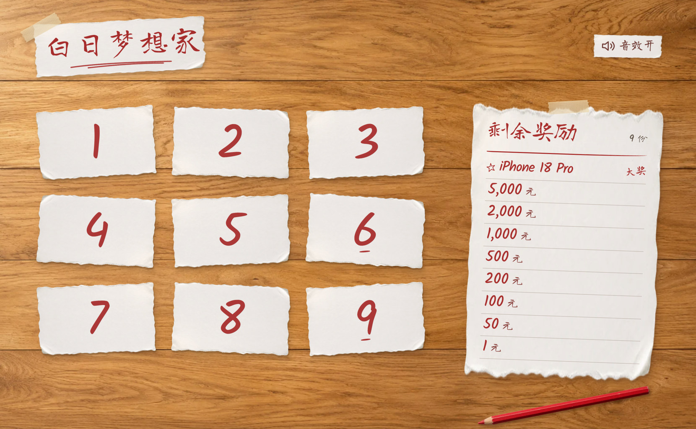
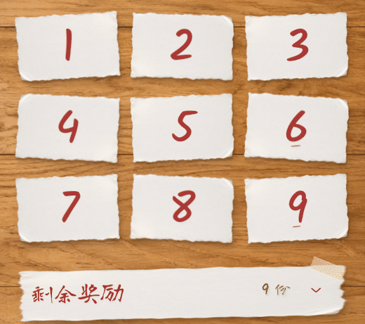

# 白日梦想家

最近在抖音爆火的 **iPhone 18 Pro 翻牌挑战**，现在可以和朋友玩同款了。桌上九张牌，一张写着「iPhone 18 Pro」，一张只写着「1 元」。

两个人共用一部手机或一台电脑。一个人翻牌，另一个人当银行家，决定什么时候开价。[开始双人游戏 →](https://bairimengxiangjia.deed.page/)

## 最后两张牌，800 元成交吗？

在这里试玩一个结局。你扣着 **5 号牌**，桌上还剩 **9 号牌**。其中一张是 **50 元**，另一张是 **2,000 元**。对面的朋友愿意出 **800 元** 买下你的牌。

<strong>成交，收下 800 元</strong>

两张牌都留在桌上，仍然扣着。你的奖金就是这笔报价。

<strong>拒绝报价，我要翻牌</strong>

最后一次换牌的机会。点你要留下的那张。

<blockquote>

<strong>保留我的 5 号牌</strong>

<strong>换成桌上的 9 号牌</strong>

</blockquote>

## 从第一张牌开始

1. **扣一张。** 从九张牌里挑自己的牌，留在原位。再翻开另一张，让两个人都看清奖励。
2. **报个价，或跳过。** 每翻开一张，银行家都可以用屏幕上的数字键盘出价。抽牌者可以成交，也可以拒绝。剩下两张时，跳过或拒绝最后的报价，就能选保留还是交换。
3. **换人再玩。** 两个人各当一次抽牌者，奖金较高的人赢得差额。手机大奖按你们约定的金额结算，开局前点奖励清单里的手机就能设置。

[和朋友开一桌 →](https://bairimengxiangjia.deed.page/)

下载后怎么玩？

解压游戏文件，用浏览器打开 `index.html`。字体、图片和音效都随游戏提供。

